<h2>Welcome to My GitHub Profile 👋</h2>

  <code>priyanshu@github:~$ ./skyline.sh --theme=sunset-fire</code>

  

  <code>priyanshu@github:~$ whoami</code>

<table>
  <tr>
    <td align="center" valign="top">
      
    </td>
    <td valign="top">
      
    </td>
  </tr>
</table>

 

  <b>Learning • Building • Improving</b>

  Thanks for visiting my profile! ⭐

